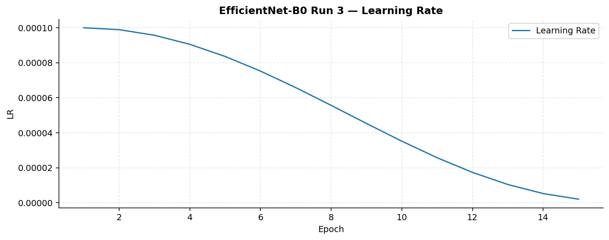
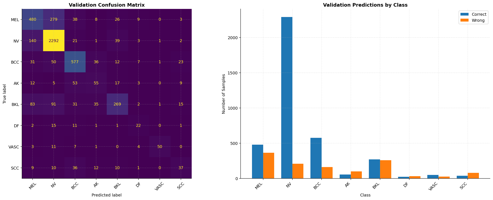
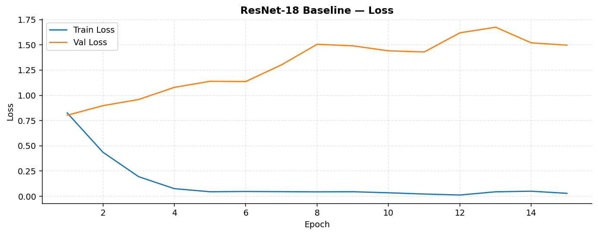
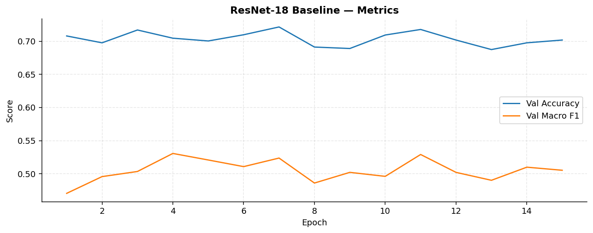
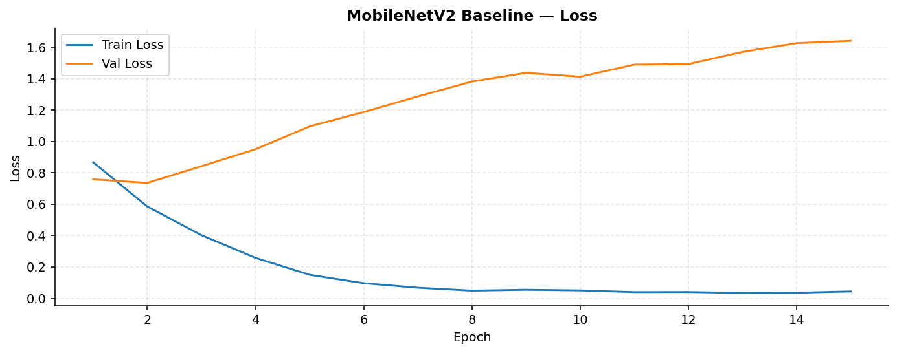
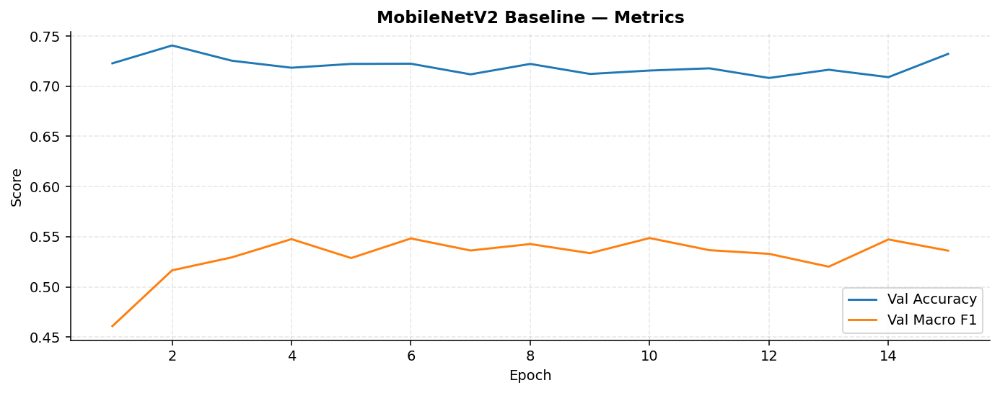
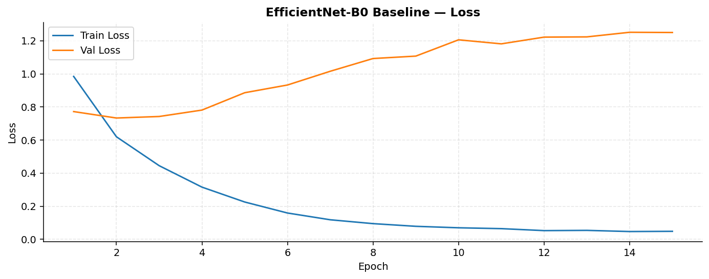
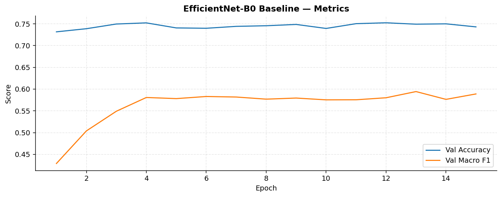

# Skin Lesion Classification with Efficient CNNs

**Deep learning · Computer vision · PyTorch · ISIC 2019**

A group research project comparing convolutional neural network backbones for multiclass dermoscopic image classification, with particular attention to reliable evaluation on imbalanced medical image data.

> **Research-only project.** The models are not validated for clinical diagnosis or patient care.

## Highlights

- Compared **ResNet-18**, **MobileNetV2**, and **EfficientNet-B0** under a common baseline setup.
- Used **lesion-aware splitting** with `StratifiedGroupKFold` to reduce train–validation leakage from multiple images of the same lesion.
- Explored **CutMix**, light augmentation, **cosine learning-rate scheduling**, and **test-time augmentation (TTA)**.
- Evaluated macro F1 alongside accuracy to account for class imbalance.

## Results

Reported **validation** metrics from the final group report and presentation (approximate baseline figures):

| Architecture | Validation accuracy | Macro F1 |
|---|---:|---:|
| ResNet-18 baseline | ~70.0% | ~0.51 |
| MobileNetV2 baseline | ~73.0% | ~0.55 |
| EfficientNet-B0 baseline | ~75.0% | ~0.58 |
| **Improved EfficientNet-B0** | **76.60%** | **0.6083** |

These are validation results, **not** evidence of clinical readiness or performance on an independent external cohort. See the [full report](docs/final_report.pdf) for experimental details and limitations.

## Project contents

| Notebook | Purpose |
|---|---|
| [01_data_preprocessing](notebooks/01_data_preprocessing.ipynb) | Dataset inspection and preprocessing |
| [02_resnet18_baseline](notebooks/02_resnet18_baseline.ipynb) | ResNet-18 experiments |
| [03_mobilenetv2_baseline](notebooks/03_mobilenetv2_baseline.ipynb) | MobileNetV2 experiments |
| [04_efficientnetb0_baseline](notebooks/04_efficientnetb0_baseline.ipynb) | EfficientNet-B0 baseline |
| [05_improved_efficientnetb0](notebooks/05_improved_efficientnetb0.ipynb) | Improved EfficientNet-B0 with augmentation and TTA |
| [06_analysis_and_report](notebooks/06_analysis_and_report.ipynb) | Additional evaluation and visualizations |
| [07_demo](notebooks/07_demo.ipynb) | Demonstration notebook |
| [08_additional_experiments](notebooks/08_additional_experiments.ipynb) | Additional experimental code |

The [final report](docs/final_report.pdf) and [presentation](docs/presentation.pdf) are included for context. Saved model weights are in [`models/`](models/).

## Data and reproducibility

The **ISIC 2019** image dataset is **not distributed** in this repository. Obtain it from the official ISIC archive and review its license and usage terms. The original notebooks expect ISIC 2019 images, ground-truth CSVs and metadata CSVs at environment-specific paths; update those paths before execution. Some analysis notebooks also refer to generated prediction CSVs not bundled here.

```bash
python -m venv .venv
source .venv/bin/activate
pip install -r requirements.txt
jupyter notebook
```

## Selected notebook visualizations

These plots are exported from stored notebook outputs; see the report for interpretation.

















